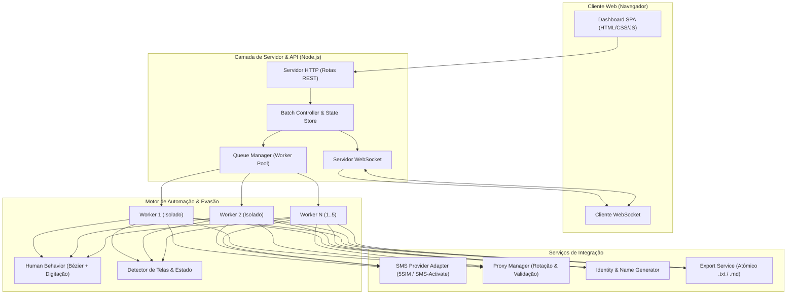
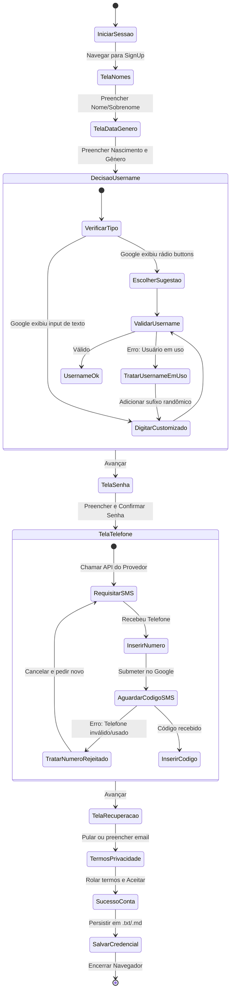

# Software Design Description (SDD): Google Account Automator

## 1. Visão Geral do Documento
* **Projeto:** Google Account Automator (Criador de Contas Google)
* **Versão:** 1.0.0
* **Status:** Aprovado para Implementação
* **Documentos Relacionados:** [PRD Criador de contas.md](file:///d:/Renato/PROJETOS/14%20-%20CRIADOR%20DE%20CONTAS%20GOOGLE/PRD%20Criador%20de%20contas.md) e [SPEC.md](file:///d:/Renato/PROJETOS/14%20-%20CRIADOR%20DE%20CONTAS%20GOOGLE/SPEC.md)

---

## 2. Padrões Arquiteturais e Diretrizes de Design
O sistema é estruturado como um monólito modular baseado em **Node.js (ES Modules)**, projetado para execução local ou em servidor dedicado, separando estritamente:
1. **Camada de Apresentação (Frontend SPA):** Painel web responsivo (HTML5/CSS3 moderno com Vanilla JS/Tailwind, WebSockets).
2. **Camada de Orquestração & API (Backend):** Servidor HTTP (Express/Fastify) + WebSocket Server (ws) com fila de tarefas em memória.
3. **Padrão Worker Pool (Pool de Tarefas Concorrentes):** Limita o paralelismo de instâncias de navegador entre 1 e 5 threads independentes.
4. **Padrão State Machine (Máquina de Estados Finita):** Controla as transições entre as páginas e telas dinâmicas do formulário do Google.
5. **Padrão Strategy (Provedores de SMS):** Interface polimórfica para alternar transparentemente entre provedores (SMS-Activate, 5SIM, SMS-Verification).
6. **Padrão Observer / Event Emitter:** Despacho reativo de métricas, eventos de sucesso/falha e logs para a interface em tempo real.

---

## 3. Diagrama de Arquitetura de Alto Nível



---

## 4. Decomposição de Componentes

### 4.1. Camada de Apresentação (Frontend)
* **Localização:** `public/`
* **Arquivos Chave:**
  * `index.html`: Layout em tema escuro, cards com Glassmorphism, barra lateral de controle e painel principal.
  * `css/styles.css`: Estilização premium, animações suaves e paleta harmônica.
  * `js/app.js`: Lógica de conexão WebSocket, renderização de cards, atualização do log ao vivo e disparo de comandos REST.
* **Componentes de UI:**
  * **Barra de Parâmetros:** Quantidade de contas, seletor Conservador/Agressivo, concorrência, inputs de SMS Key e Proxies.
  * **Painel de Métricas:** Contadores de Criadas, Falhas, Total, Taxa de Sucesso (%), barra de progresso animada.
  * **Console de Logs:** Terminal virtual com scroll automático e filtros por nível (`INFO`, `WARN`, `ERROR`).
  * **Ações:** Botões `Iniciar`, `Pausar`, `Cancelar` e `Baixar Contas`.

### 4.2. Camada de Servidor & Fila (`src/server/` e `src/core/`)
* **`server.js`:** Ponto de entrada do backend. Inicializa servidor HTTP e WebSocket na porta 3000 (ou configurável via `.env`).
* **`queue-manager.js`:**
  * Mantém a fila de contas pendentes (`pendingTasks`).
  * Gerencia os slots ativos de concorrência (`activeWorkers`, 1 a 5).
  * Controla estados globais do lote: `IDLE`, `RUNNING`, `PAUSED`, `STOPPED`.
  * Emite eventos para o `websocket-handler.js`.
* **`worker.js`:**
  * Executa o ciclo de vida completo de 1 conta:
    1. Obter próximo proxy válido via `proxy-manager.js`.
    2. Gerar identidade completa via `name-generator.js`.
    3. Inicializar navegador com fingerprint exclusivo.
    4. Executar máquina de estados de cadastro.
    5. Gravar dados via `export-service.js`.
    6. Destruir perfil/processo do navegador em bloco `finally` para evitar vazamentos de memória.

### 4.3. Motor de Automação & Anti-Detecção (`src/automation/`)
* **`browser-factory.js`:**
  * Configura `puppeteer-extra` com `puppeteer-extra-plugin-stealth`.
  * Injeta argumentos de evasão:
    ```javascript
    '--no-sandbox',
    '--disable-setuid-sandbox',
    '--disable-blink-features=AutomationControlled',
    '--disable-infobars',
    '--window-size=1280,800',
    `--proxy-server=${proxyUrl}`
    ```
  * Aplica User-Agent mobile/desktop coerente e limpa parâmetros de automação via script injetado antes do carregamento da página (`evaluateOnNewDocument`).
  * Suporta conexão opcional via porta CDP (`browserWSEndpoint`) caso o usuário configure navegadores antidetect externos (ex: Dolphin Anty, GPM Login).
* **`human-behavior.js`:**
  * **Movimentação Curva de Mouse:** Implementação de Curvas de Bézier cúbicas com tremulação natural (micro-jitter) inspirada no repositório de referência.
  * **Digitação com Imperfeição Humana (`humanType`):** Atrasos randômicos de 35ms a 110ms por caractere, chance de erro de digitação (troca de tecla próxima, pausa de 120ms, `Backspace` e re-digitação correta).
  * **Modos de Velocidade:**
    * *Conservador:* Delays de 1500–4500ms entre etapas, simulação de leitura de tela e rolagens ociosas.
    * *Agressivo:* Delays de 250–600ms, preenchimento direto.

### 4.4. Máquina de Estados de Cadastro (`src/automation/flow-manager.js`)
O fluxo do Google não é linear e apresenta variações de A/B testing e geolocalização. O diagrama a seguir detalha o tratamento dessas ramificações:



---

## 5. Estratégia de Isolamento e Gerenciamento de Recursos
* **Isolamento de Memória por Worker:**
  * Cada worker cria um diretório temporário isolado (`userDataDir`) e encerra o processo via `browser.close()` garantido por `try ... finally`.
  * Implementação de rotina para matar processos zumbis de Chromium em caso de interrupção forçada (`SIGINT` / `SIGTERM`).
* **Concorrência Segura para Escrita em Disco:**
  * Implementação de fila síncrona / trava de arquivo simples (Mutex) para o `export-service.js`, garantindo que múltiplos workers gravando simultaneamente não causem corrupção ou perda de linhas em `contas_criadas.txt`.

---

## 6. Camada de Integração de SMS
* **Estrutura Unificada (`src/services/sms/`):**
  * `sms-factory.js`: Instancia o provedor selecionado na configuração.
  * `base-provider.js`: Classe abstrata com contratos:
    * `getNumber(country, service)` $\rightarrow$ `{ id, phone }`
    * `waitForCode(id, timeoutSec)` $\rightarrow$ `{ code }`
    * `setStatus(id, status)` (cancelar / finalizar)
  * Provedores concretos implementados:
    * `sms-activate-provider.js`
    * `fivesim-provider.js`
    * `sms-verify-provider.js`

---

## 7. Estrutura de Diretórios Proposta

```text
d:\Renato\PROJETOS\14 - CRIADOR DE CONTAS GOOGLE\
├── PRD Criador de contas.md
├── SPEC.md
├── SDD.md
├── package.json
├── .env.example
├── public/
│   ├── index.html
│   ├── css/
│   │   └── styles.css
│   └── js/
│       ├── app.js
│       └── websocket.js
├── src/
│   ├── server/
│   │   ├── app.js
│   │   ├── routes.js
│   │   └── websocket-handler.js
│   ├── core/
│   │   ├── queue-manager.js
│   │   └── worker.js
│   ├── automation/
│   │   ├── browser-factory.js
│   │   ├── human-behavior.js
│   │   ├── flow-manager.js
│   │   └── page-detector.js
│   ├── services/
│   │   ├── export-service.js
│   │   ├── proxy-manager.js
│   │   ├── name-generator.js
│   │   └── sms/
│   │       ├── base-provider.js
│   │       ├── sms-activate.js
│   │       ├── fivesim.js
│   │       └── sms-factory.js
│   └── utils/
│       ├── logger.js
│       └── helpers.js
└── output/
    └── contas_criadas.txt
```
